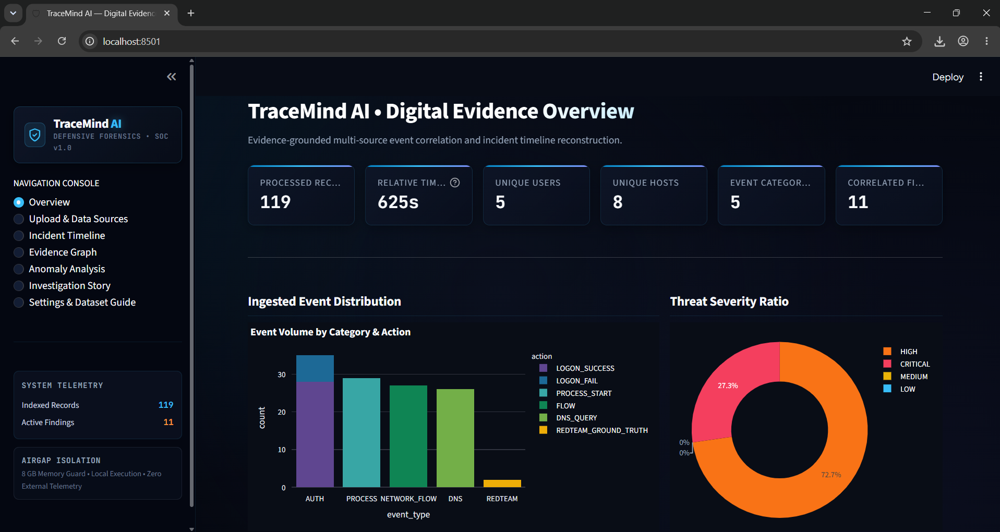
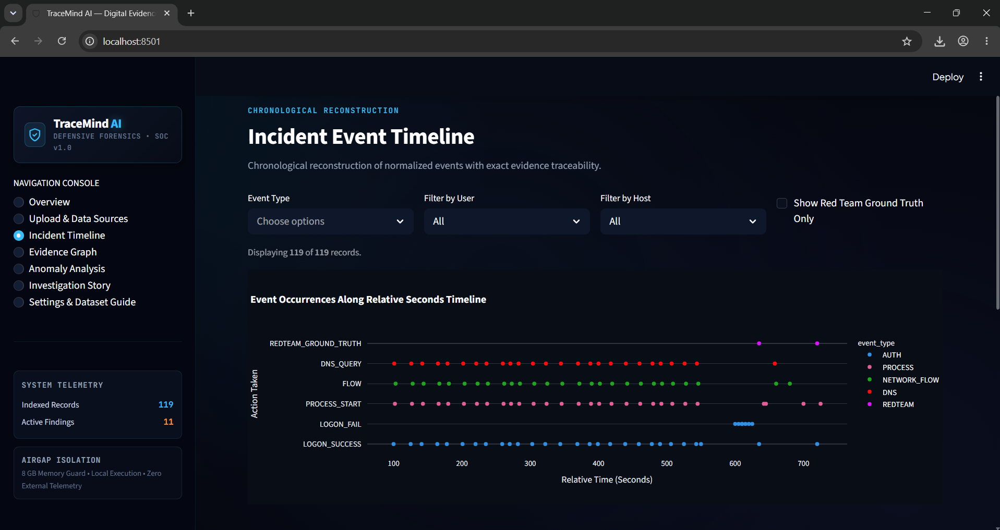
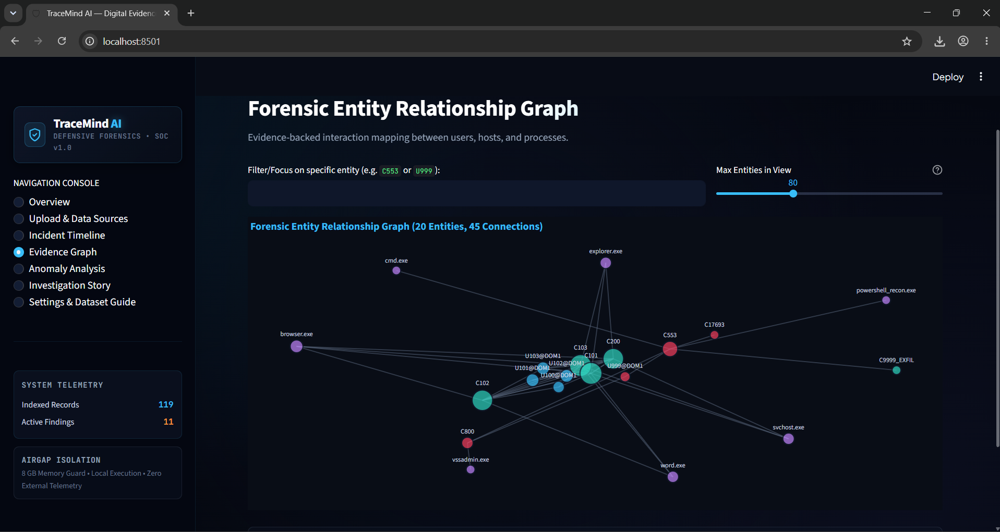
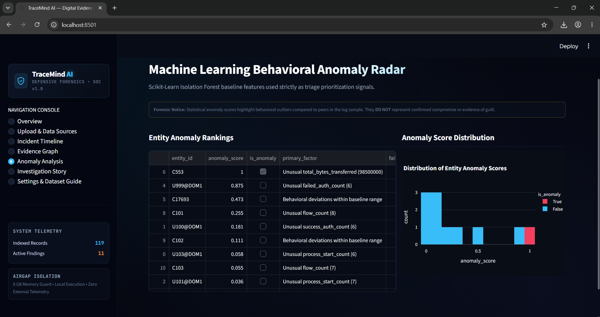
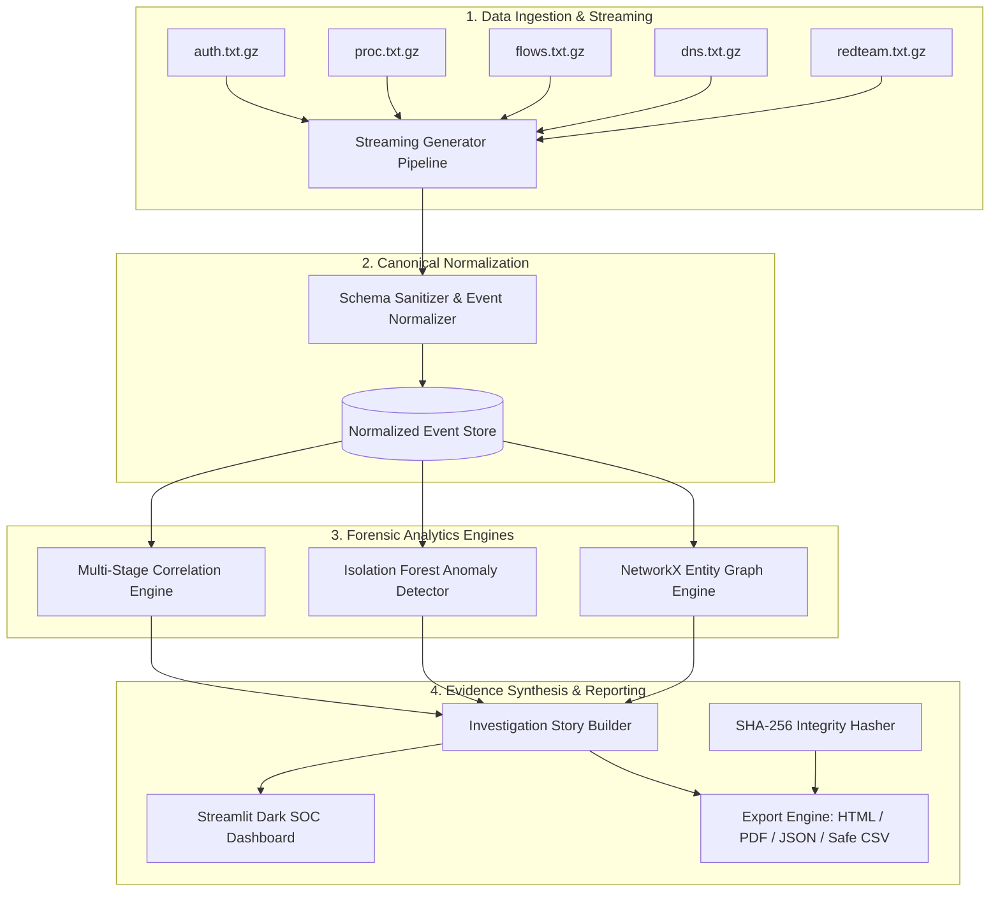

# TraceMind AI — Digital Evidence Story Builder

[](https://www.python.org/)
[](https://streamlit.io/)
[](https://scikit-learn.org/)
[](https://plotly.com/)
[](https://docs.pytest.org/)
[](LICENSE)

> **Local-first, memory-efficient digital forensics and cybersecurity investigation platform.**  
> Correlates multi-source enterprise security telemetry, maps compromised entities, flags behavioral anomalies with unsupervised ML, and constructs audit-grade forensic incident dossiers without cloud dependencies or paid APIs. Optimized to run within **8 GB RAM** on standard endpoints.

---

## 📌 Executive Overview & Visual Highlights

### 1. Digital Evidence Overview Dashboard
Executive overview tracking processed log events, unique identities, affected hosts, event categories, and threat severity ratios.


### 2. Chronological Incident Event Timeline
Multi-source log correlation reconstructing the complete attack lifecycle with relative timestamp filtering, host/user filters, and ground-truth red team markers.


### 3. Forensic Entity Relationship Graph
Interactive NetworkX and Plotly graph mapping interactions between Users, Hosts, and Processes, highlighting blast radius and lateral movement paths.


### 4. Machine Learning Behavioral Anomaly Radar
Unsupervised Scikit-Learn **Isolation Forest** scoring entity behavioral outliers based on authentication failures, host fan-out, process spawns, and abnormal byte transfers.


---

## 🌟 Key Capabilities

| Capability | Description | Forensic Value |
| :--- | :--- | :--- |
| **Incremental Stream Processing** | Line-by-line streaming via Python `gzip` generators. Never loads entire multi-gigabyte dumps into RAM. | Guarantees deterministic execution within 8 GB RAM constraints. |
| **Official LANL Cyber Schema** | Full parser support for `auth.txt.gz`, `proc.txt.gz`, `flows.txt.gz`, `dns.txt.gz`, and `redteam.txt.gz`. | Preserves relative integer timestamps and handles missing (`?`) attributes safely. |
| **Multi-Stage Event Correlation** | Links failed logons &rarr; successful compromise &rarr; anomalous process execution &rarr; DNS tunneling &rarr; high-volume exfiltration. | Every finding explicitly cites exact source filenames and record line numbers. |
| **Interactive Entity Graph** | 2D dynamic graph with node sizing proportional to network degree centrality and color-coded entity types. | Visually isolates Patient Zero and compromised lateral infrastructure. |
| **Unsupervised Anomaly Triage** | Isolation Forest baseline scoring multi-dimensional behavior vectors. | Serves as an analytical prioritization triage signal, distinct from factual proof of guilt. |
| **Cryptographic Custody & Safe Export** | Streaming chunked SHA-256 integrity digests with CSV formula injection defense. | Generates tamper-evident JSON, interactive standalone HTML, and court-ready PDF dossiers. |

---

## 🏗️ System Architecture



---

## 📂 Project Structure

```text
TraceMind-AI/
├── app.py                      # Main Streamlit web application & SOC UI
├── requirements.txt            # Project dependencies
├── pytest.ini                  # Pytest configuration
├── README.md                   # Project documentation
├── .gitignore                  # Git ignore rules
├── assets/                     # UI screenshots & visual artifacts
│   ├── 1.png                   # Overview Dashboard
│   ├── 2.png                   # Incident Event Timeline
│   ├── 3.png                   # Forensic Entity Relationship Graph
│   └── 4.png                   # ML Behavioral Anomaly Radar
├── src/                        # Core investigation modules
│   ├── parsers.py              # Memory-safe incremental streaming log parsers
│   ├── normalizer.py           # Canonical schema mapping & input sanitization
│   ├── correlation_engine.py   # Multi-stage explainable rule correlation
│   ├── anomaly_detector.py     # Isolation Forest unsupervised behavioral scoring
│   ├── evidence_graph.py       # NetworkX + Plotly entity interaction graphs
│   ├── story_builder.py        # Narrative timeline & evidence synthesis
│   ├── integrity.py            # SHA-256 custody digests & provenance records
│   └── export.py               # Formula-safe CSV, JSON, HTML, and PDF export
├── data/
│   ├── synthetic_generator.py  # Realistic LANL attack scenario generator
│   └── synthetic/              # Bundled sample logs (.txt.gz)
├── docs/                       # Technical & forensic documentation
│   ├── architecture.md         # Detailed pipeline & algorithmic design
│   ├── dataset_guide.md        # LANL schema specifications
│   └── limitations.md          # Scientific & forensic boundaries
├── reports/                    # Exported sample investigation reports
└── tests/                      # Automated test suite (21 unit tests)
    ├── test_parsers.py
    ├── test_normalizer.py
    ├── test_correlation.py
    ├── test_anomaly_detector.py
    ├── test_evidence_graph.py
    ├── test_integrity.py
    └── test_export.py
```

---

## ⚡ Quickstart Guide

### 1. Prerequisites
- **Python 3.10, 3.11, or 3.12**
- Git installed on your system
- Operating System: Windows, Linux, or macOS

### 2. Clone the Repository
```bash
git clone https://github.com/<your-username>/TraceMind-AI.git
cd TraceMind-AI
```

### 3. Create & Activate Virtual Environment

**On Windows (PowerShell):**
```powershell
python -m venv .venv
.\.venv\Scripts\Activate.ps1
```

**On Linux / macOS:**
```bash
python3 -m venv .venv
source .venv/bin/activate
```

### 4. Install Dependencies
```bash
pip install -r requirements.txt
```

### 5. Generate Synthetic Test Logs (Optional)
TraceMind AI comes with sample logs in `data/synthetic/`. To regenerate customized synthetic scenarios:
```bash
python data/synthetic_generator.py
```

### 6. Run Automated Test Suite
Verify all stream parsers, correlation engines, anomaly scorers, and export utilities:
```bash
pytest -v
```

### 7. Launch the TraceMind AI Dashboard
Start the Streamlit web dashboard:
```bash
streamlit run app.py
```

The application will open automatically in your browser at:
```text
http://localhost:8501
```

---

## 🔬 Dataset Information

TraceMind AI natively supports the **Los Alamos National Laboratory (LANL) Comprehensive Multi-Source Cyber-Security Events** dataset:
- Official Source: [https://csr.lanl.gov/data/cyber1/](https://csr.lanl.gov/data/cyber1/)

### Supported Log Formats:
1. `auth.txt.gz`: Authentication events (Logon, Logoff, Failure, Auth Type)
2. `proc.txt.gz`: Process execution events (Process Start, Process End, Host)
3. `flows.txt.gz`: Network flow connections (Source/Dest Hosts & Ports, Byte counts)
4. `dns.txt.gz`: DNS lookups and resolution queries
5. `redteam.txt.gz`: Ground-truth adversary simulation activities

---

## 🛡️ Forensic Chain of Custody & Security Disclaimers

1. **Analytical Hypotheses vs. Ground Truth**:
   Statistical anomalies identified by the Isolation Forest are prioritized triage signals. They highlight deviations relative to peer baselines and do not constitute legal proof of malice.
2. **Cryptographic Integrity**:
   Every ingested artifact receives a streaming SHA-256 digest computed in 64 KB blocks before parsing.
3. **CSV Formula Injection Mitigation**:
   All tabular exports prepend an apostrophe (`'`) to cells starting with dangerous dynamic execution characters (`=`, `+`, `-`, `@`).

---

## 📜 License
Distributed under the **MIT License**. See `LICENSE` for more information.
